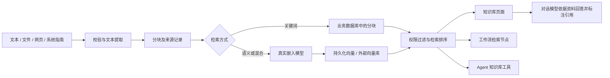

# Flowly RAG 模块：作用、使用和实现说明

本文对应 2026-10-19 的功能实现。RAG 的作用是让系统在回答或执行前，先查询你提供的资料，并把可追溯的依据交给模型。它不会训练模型、自动获得业务知识，也不会自动修复工作流。

## 1. 它为 Flowly 提供什么

| 场景 | 放入的知识 | 使用入口 | 带来的作用 |
| --- | --- | --- | --- |
| 系统使用与排障 | Flowly 指南、节点配置说明、经过确认的故障处理记录 | 知识库 → 知识问答 | 回答“工作流失败后检查什么”，同时显示引用文档 |
| 企业业务问答 | 产品手册、客服政策、操作规范 | RAG 流水线 / Agent 知识库工具 | 回答基于企业资料，减少凭空回答 |
| 自动化内容生成 | 模板、品牌规范、项目背景 | 工作流的检索节点 → 大模型节点 | 为后续生成提供已有约束和参考内容 |
| 项目资料复用 | 项目需求、已确认的技术决策、项目 Agent 对话记录 | 项目知识库 / 检索节点 | 把跨会话资料保存在数据库中，便于再次检索 |

关键价值是“同一份知识可以被页面、工作流和 Agent 共同使用”。仅添加一张知识库页面并不能实现这个价值；入库、索引、检索、权限和引用必须连接起来。

建议先建设一个“Flowly 运维知识库”，再按项目或团队建立业务知识库。不要把不同客户的私密资料放进同一个共享知识库。模型生成的项目对话记录也不是已核实的事实，应和正式操作规范区分来源。

## 2. 原来失效的原因与本次处理

- 原嵌入服务失败后返回随机向量，检索分数没有语义意义。现在真实服务失败会明确报错，并保存可重试的失败状态。
- 原内存索引按请求新建，下一次请求或进程重启后数据不可检索。现在原 `memory` 类型在知识库业务中使用数据库中的 `Chunk` 和 `embedding` 持久化。
- 原多个知识库共用向量集合名，Qdrant 每次入库还会重建集合。现在按知识库 UUID 隔离命名，已有集合只校验并复用。
- 原重新处理会创建新文档，异步任务调用不存在的方法。现在 HTTP、Celery 和批量重建调用同一个处理器，保留文档 ID，替换旧分块。
- 原删除只删除数据库记录，没有完整清理索引。现在删除文档时清理外部向量；检索结果还会按当前数据库中的有效分块重新核对。
- 原 API 字段转换与页面读取方式不一致。现在 RAG 请求保留文档约定的 snake_case 字段及自定义元数据键。
- 原页面包含固定的分块分布、错误状态名称、无效的存储配置项，分页后文档不完整。现在统计来自真实数据，列表读取全部分页，配置项和后台一致。
- 原无资料时仍直接向模型提问，生成错误还可能包装成成功回答。现在无依据时直接返回 `no_evidence`，模型失败返回 HTTP 503。
- 工作流和 Agent 读取知识库时现在检查执行用户的当前权限；绑定过的知识库在权限撤销后也不能继续读取。

## 3. 数据如何流动



`VectorStore` 保存连接配置；`DocumentCollection` 保存知识库、权限、分块和检索设置；`Document` 保存原文、来源与处理状态；`Chunk` 保存分块、字符位置和可选的真实向量；`RAGPipeline` 保存可复用的问答参数与使用次数。

## 4. 第一次使用

1. 后端安装已有的 `Backend/requirements.txt`，执行 `python manage.py migrate rag`，重启 Django 和正在运行的 Celery worker。
2. 登录 Flowly，进入“知识库”，创建集合。保留“关键词检索”即可使用；未选择默认存储时会创建个人的本地持久化存储。
3. 打开集合，点击“导入 Flowly 使用指南”。仅导入白名单内的 `README.md`、`PRODUCT.md` 和本文。不会扫描 `.env`、凭证或任意代码文件。
4. 也可以上传自己的文档、粘贴文本或导入公开网页。
5. 在“搜索测试”输入“工作流失败”，先确认返回的文档和相关度符合预期。
6. 在“知识问答”提问“工作流执行失败后，应该如何排查？”。若平台对话模型可用，得到基于资料的回答；点击引用可查看原文与分块。
7. 若要复用不同的提示词、Top-K 和引用设置，在知识库首页的“RAG 流水线”创建配置并查询。

“导入 Flowly 使用指南”可重复点击：内容未改变时跳过，改变时更新原文并重建分块。部署时要把这三份 Markdown 文件与 Backend 一起保留，否则返回缺失文件的明确错误。

## 5. 三种检索方式

| 模式 | 依赖 | 排序方式 | 适用情况 |
| --- | --- | --- | --- |
| 关键词 `keyword` | 业务数据库 | 中文单字/双字及英文词项的 BM25 | 无需配置模型即可验证链路，适合明确术语和编号 |
| 语义 `semantic` | 真实嵌入服务 | 向量余弦相关度 | 同义表达、表达方式不同的提问 |
| 混合 `hybrid` | 真实嵌入服务 | BM25 与向量结果的倒数排名融合 | 同时兼顾术语与语义 |

关键词模式不是语义模型，不应期待它识别所有同义词。相关度展示的是排序分数，不是“回答正确率”；不同模式的分数不可直接比较。默认阈值为 0，只返回有实际匹配且分数大于 0 的结果；提高阈值可能导致没有结果。

现有知识库在迁移后使用关键词模式，使历史分块能先恢复检索。若需要语义检索，请显式选择模式并重新处理文档。历史流水线已经保存的阈值不自动改写；如果旧阈值 0.7 导致无结果，可在 API 中更新或新建适当配置。

### 嵌入模型配置

OpenAI 兼容接口：

```dotenv
RAG_EMBEDDING_BASE_URL=https://your-provider.example/v1
RAG_EMBEDDING_API_KEY=填入真实凭证
```

集合中的模型名填写 `openai:你的嵌入模型名`；未单独设置时使用平台的 `OPENAI_BASE_URL` 与 `OPENAI_API_KEY`。对话模型和嵌入模型是两种不同接口，不能把聊天模型名称当成嵌入模型。

本地 Ollama：安装真实的嵌入模型后，在集合中填写 `ollama:nomic-embed-text` 或其他已安装模型，地址使用 `OLLAMA_BASE_URL`。不会在云端嵌入失败后自动换成另一个模型，也不会生成随机向量。

修改检索模式、嵌入模型或分块参数后，文档进入“待处理”，旧索引暂停参与检索。在集合设置点击“重新处理所有文档”，查看每份文档结果。失败文档可单独重试。

### 回答模型配置

默认沿用平台的 OpenAI/Ollama 对话模型；也可为 RAG 单独配置 OpenAI 兼容服务：

```dotenv
RAG_CHAT_MODEL=你的对话模型名称
RAG_CHAT_BASE_URL=https://your-provider.example/v1
RAG_CHAT_API_KEY=填入真实凭证
```

这三个值只保存在服务端环境变量中。没有可用对话模型时仍能入库和检索，问答接口会明确返回依赖不可用，不会冒充已生成回答。文档作为参考数据传入，提示词要求忽略文档中的指令、仅使用资料回答；这降低了风险，但并不构成对模型回答正确性的数学保证。

## 6. 文档支持及处理行为

支持 TXT、Markdown、CSV、JSON、HTML、PDF、DOCX、XLSX、PPTX；网页 URL 仅接收公开 HTTP/HTTPS 文本或 HTML。

- PDF 提取文本层；图片扫描件不含文本时拒绝并提示先 OCR。
- DOCX 提取段落和表格；XLSX 读取单元格缓存值；PPTX 按页提取文本。
- 不支持旧版 `.doc`、加密 PDF、任意二进制文件，也不会把二进制文件当文本吞进去。
- 网页抓取会移除脚本/样式，检查重定向并限制响应大小；拒绝回环、内网和保留地址，防止知识导入请求访问内部服务。
- 默认最大文件 20 MiB、提取文本 200 万字符；Office 压缩文件也限制解压体积。
- 分块有固定长度和段落/句子边界两种策略。重叠必须小于分块大小，末尾不会循环复制。
- 同步 HTTP 上传会显示处理中反馈，并在索引完成或失败后返回。已有 Celery 任务入口使用同一处理器，但普通上传不会伪装成已排队的异步任务。
- 原文保存在数据库，原始二进制文件不作为附件保留。Token 数是字符数估算，分块统计使用实际字符数。

## 7. 接入工作流与 Agent

工作流中添加“检索”节点，在配置中选择“Flowly 知识库”、具体集合、查询内容及 Top-K。查询可以引用工作流输入变量。选择这一来源后，会使用集合设置的关键词/语义/混合方式。

检索节点输出：

```json
{
  "query": "工作流失败怎么办",
  "documents": [{"text": "相关原文", "score": 0.6, "id": "分块 UUID", "metadata": {"title": "排障指南", "doc_id": "文档 UUID"}}],
  "context": "[1] 排障指南\n相关原文",
  "sources": [{"title": "排障指南", "doc_id": "文档 UUID"}],
  "count": 1,
  "provider": "knowledge_base",
  "collection_id": "知识库 UUID"
}
```

把检索节点的 `context` 映射到后续大模型节点的提示词上下文，把原问题一起传入，并要求回答引用 `[1]`。最终输出保留 `sources`，方便调用者核对。不应只显示模型文本而丢弃证据。

元数据过滤采用简单键值相等，如 `{"category":"ops"}`，不接受任意数据库表达式。检索节点已有独立重排序模型选项；它需要另行安装并加载对应模型，不是 RAG 默认运行的必要条件。

Agent 设置中关联知识库并启用 `knowledge_base` 工具。执行时会重新检查当前用户的权限，工具返回内容、相关度和来源元数据。共享 Agent 不会因此把原拥有者的私有知识库授权给其他用户。Project Agent 现有的 `append_rag_memory` 也复用同一入库处理器。

## 8. API 速查

基础前缀 `/api/v1/rag/`；除登录外都需要登录凭证。GET 检索参数用 query string，POST 使用 JSON；文件上传使用 multipart。

| 方法与路径 | 用途 |
| --- | --- |
| `GET/POST collections/` | 列表/创建知识库 |
| `GET/PATCH/DELETE collections/{id}/` | 查看/配置/删除知识库 |
| `POST collections/{id}/add_document/` | `{title, content, metadata?}` 导入文本 |
| `POST collections/{id}/upload_file/` | 上传 `file` |
| `POST collections/{id}/add_url/` | `{url, title?}` 导入网页 |
| `POST collections/{id}/import_guides/` | 导入或更新 Flowly 指南 |
| `GET/POST collections/{id}/search/` | `{query, top_k?, min_similarity?, filters?}` 检索 |
| `POST collections/{id}/ask/` | 同上，基于检索资料回答 |
| `POST collections/{id}/reindex/` | 全库重新处理，返回每份文档结果 |
| `GET collections/{id}/stats/` | 真实计数、状态分布、文本体积 |
| `DELETE collections/{id}/clear/` | 清空文档和索引 |
| `GET collections/capabilities/` | 格式、大小限制、模式、分块策略 |
| `GET documents/?collection={id}` | 分页读取文档 |
| `GET/PATCH/DELETE documents/{id}/` | 原文查看/更新并重建/删除 |
| `POST documents/{id}/reprocess/` | 重试或重新处理同一文档 |
| `GET documents/{id}/chunks/` | 文档分块与来源位置 |
| `GET chunks/?collection={id}` | 分页读取知识库分块 |
| `POST pipelines/{id}/query/` | 使用流水线参数问答 |
| `GET pipelines/{id}/retrieve/` | 使用流水线参数只检索 |

问答返回 `response`、`sources`、`grounded`、`answer_status`、`retrieved_count`。`grounded=true` 表示模型收到了检索依据，不代表每句回答都已人工核实。无匹配时 `answer_status=no_evidence`；模型异常返回 HTTP 503；参数和文件错误返回 HTTP 400；越权资源返回 404 或 403。

个人知识库只对本人开放；团队成员可查看、查询和添加文档。配置修改、重建、清空及删除由拥有者或团队管理员操作。向量存储凭证只写入、不回传，空白修改不覆盖已有凭证。

## 9. 部署和容量

本地存储不需要额外的向量数据库，备份业务数据库即可同时备份原文、分块和向量。可选的外部驱动清单是 `Backend/requirements-rag.txt`，按需安装；外部服务地址和凭证在“向量存储”中配置。Qdrant 支持服务连接及本地路径；Chroma 支持持久化路径或 HTTP 服务。Milvus、Pinecone、Weaviate 仍需要各自服务及正确配置。

外部库按 `flowly_<知识库UUID>` 分隔索引，Pinecone 将下划线转换为连字符。已有旧版共享集合不会被自动删除，因为其中可能混有多个知识库的数据；确认迁移后由管理员清理。

| 环境变量 | 默认值 | 用途 |
| --- | --- | --- |
| `RAG_MAX_FILE_BYTES` | 20971520 | 单文件/网页响应上限 |
| `RAG_MAX_TEXT_CHARS` | 2000000 | 文档文本字符上限 |
| `RAG_MAX_QUERY_CHARS` | 4000 | 查询字符上限 |
| `RAG_CONTEXT_CHARS` | 16000 | 交给回答模型的资料字符预算 |
| `RAG_REQUEST_TIMEOUT` | 45 | 嵌入与外部连接超时秒数 |
| `RAG_EMBEDDING_BATCH_SIZE` | 32 | 嵌入批量大小 |
| `RAG_CANDIDATE_LIMIT` | 10000 | 单库可参与检索的分块上限 |
| `RAG_PINECONE_CLOUD/REGION` | aws / us-east-1 | Pinecone 索引部署区域 |
| `RAG_WEAVIATE_GRPC_PORT` | 50051 | Weaviate 客户端 gRPC 端口 |

当前实现面向中小知识库。关键词评分和本地向量排序在应用进程中进行；混合检索也需要读取候选分块。超过候选上限会明确失败，不会静默只搜一部分。大型知识库需要专门的全文索引、服务端过滤/混合检索、任务队列和离线评测；仅换外部向量数据库不会自动消除所有应用层扫描成本。

## 10. 运维与验收

先确认文档状态是“已处理”，再检索。若无结果，依次检查：知识库选择、文档状态、查询措辞、过滤条件、阈值、模式及模型配置。若生成失败，先做“搜索测试”；能搜到资料而问答失败说明对话模型链路需要处理。若改了索引配置，应重新处理文档。Celery worker 和 Django 都需在升级后重启。

测试使用独立测试数据库，不把真实业务数据作为清理对象：

```powershell
.\.venv\Scripts\python.exe tests/run_project_tests.py E:/Flowly-now/tests/backend/test_rag.py E:/Flowly-now/tests/backend/test_rag_functional.py
cd Frontend
npm run test:run
npm run build
```

本次具体通过数量、浏览器验证和限制以 `Docs/verification/rag-20261019/README.md` 为准。浏览器验证使用 Chrome DevTools MCP，不使用其他浏览器自动化工具替代。

外部适配器实现参考：[Qdrant 集合管理](https://qdrant.tech/documentation/manage-data/collections/)、[Chroma Python 客户端](https://docs.trychroma.com/reference/python)、[Milvus 集合](https://milvus.io/docs/create-collection.md)、[Pinecone 向量接口](https://sdk.pinecone.io/python/how-to/vectors/upsert-and-query.html)、[Weaviate Python 客户端](https://docs.weaviate.io/weaviate/client-libraries/python)。
