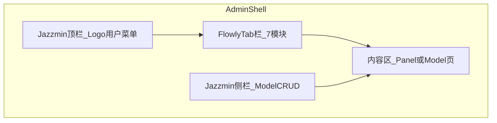

# 管理端 UI 优化文档体系

> **范围**：Django Admin + Jazzmin，入口 `http://127.0.0.1:8000/admin/`  
> **不包含**：Vue Frontend（`:5200`）的用户端界面  
> **最后更新**：2026-06-12

---

## 一、这套文档是干什么的

本目录将管理端 UI 优化拆成 **A → B → C → D 四个阶段**，每份文档包含：

- 为什么要做
- 具体任务清单（可勾选）
- 涉及代码文件
- 完成标准与验收条件

**用法**：按阶段阅读 → 在 [`PROGRESS.md`](PROGRESS.md) 更新进度 → 确认后再切 Agent 模式改代码。

---

## 二、管理端架构概览

| 层级 | 职责 | 典型入口 |
|------|------|----------|
| Jazzmin 顶栏 | 品牌、用户菜单、外链（API / 用户端） | 全局 |
| Flowly Tab 栏 | 运营/监控/配置 Panel 切换 | `/admin/flowly/*` |
| Jazzmin 侧栏 | 数据 CRUD（工作流、用户、Agent 等） | `/admin/workflows/...` |
| 内容区 | Flowly 自定义 Panel 或 Jazzmin 列表/表单 | 各路由 |

---

## 三、文档目录

| 文件 | 说明 |
|------|------|
| [`PROGRESS.md`](PROGRESS.md) | **进度看板**（优先看这个） |
| [`00-current-state.md`](00-current-state.md) | 现状：已完成 vs 遗留 |
| [`01-phase-a-information-architecture.md`](01-phase-a-information-architecture.md) | Phase A：信息架构与导航收敛 |
| [`02-phase-b-visual-unification.md`](02-phase-b-visual-unification.md) | Phase B：视觉统一（Panel + Jazzmin） |
| [`03-phase-c-interaction-ux.md`](03-phase-c-interaction-ux.md) | Phase C：交互与体验打磨 |
| [`04-phase-d-architecture-maintainability.md`](04-phase-d-architecture-maintainability.md) | Phase D：架构与可维护性 |
| [`05-acceptance-checklist.md`](05-acceptance-checklist.md) | 统一验收清单 |
| [`references/design-system-map.md`](references/design-system-map.md) | f-* 组件 ↔ Jazzmin 对照 |
| [`references/key-files-index.md`](references/key-files-index.md) | 关键代码文件速查 |

---

## 四、建议阅读与实施顺序

1. [`00-current-state.md`](00-current-state.md) — 了解起点
2. [`01-phase-a-information-architecture.md`](01-phase-a-information-architecture.md) — P0，导航不困惑
3. [`02-phase-b-visual-unification.md`](02-phase-b-visual-unification.md) — P0，内外一套皮
4. [`04-phase-d-architecture-maintainability.md`](04-phase-d-architecture-maintainability.md) — D1 可与 B 并行
5. [`03-phase-c-interaction-ux.md`](03-phase-c-interaction-ux.md) — P1，细节质感
6. [`05-acceptance-checklist.md`](05-acceptance-checklist.md) — 收尾验收

**能力有限时的最小路径**：A + B1–B3 + D1（约 3 天可见质变）。

---

## 五、关键代码路径（快速跳转）

| 用途 | 路径 |
|------|------|
| Admin Site 路由与 Tab context | [`Backend/config/admin_site.py`](../../Backend/config/admin_site.py) |
| Tab 定义常量 | [`Backend/admin/constants.py`](../../Backend/admin/constants.py)（`FLOWLY_ADMIN_TABS`） |
| Panel 基模板 | [`Backend/templates/admin/flowly_base.html`](../../Backend/templates/admin/flowly_base.html) |
| Tab 栏片段 | [`Backend/templates/admin/includes/flowly_tab_bar.html`](../../Backend/templates/admin/includes/flowly_tab_bar.html) |
| Shell 样式（Tab / 页头 / a11y） | [`Backend/admin_static/admin/css/flowly_shell.css`](../../Backend/admin_static/admin/css/flowly_shell.css) |
| Jazzmin 全局覆盖 | [`Backend/admin_static/admin/css/custom_admin.css`](../../Backend/admin_static/admin/css/custom_admin.css) |
| Jazzmin 配置 | [`Backend/config/settings.py`](../../Backend/config/settings.py)（`JAZZMIN_SETTINGS`） |
| 配置中心 JS | [`Backend/admin_static/admin/js/settings_modules.js`](../../Backend/admin_static/admin/js/settings_modules.js) |
| 登录页 | [`Backend/templates/admin/login.html`](../../Backend/templates/admin/login.html) |

---

## 六、Flowly Panel 路由一览

| Tab | URL | 模板 |
|-----|-----|------|
| 欢迎 | `/admin/` | `flowly_welcome.html` |
| 控制台 | `/admin/flowly/` | `flowly_dashboard.html` |
| 配置中心 | `/admin/flowly/settings/` | `flowly_settings_hub.html` |
| 功能开关 | `/admin/flowly/features/` | `features_panel.html` |
| AI 模型 | `/admin/flowly/ai-models/` | `ai_models_panel.html` |
| 审计 | `/admin/flowly/audit/` | `audit_panel.html` |
| 系统 | `/admin/flowly/system/` | `system_panel.html` |

---

## 七、设计原则（全阶段遵守）

1. **深蓝 + 白色** 主题，禁止紫色及杂色渐变作为主色
2. **Tab 整页跳转**（方案 1），不做 SPA 无刷新切换（除非单独立项）
3. **Restrained 配色**：主 accent `#1d4ed8`，中性色带 navy 色调
4. **无障碍**：Tab ≥44px 触控、`:focus-visible`、跳过链接、键盘 Tab 导航
5. **浏览器测试**：使用 `chrome-devtools` MCP，禁止 `cursor-ide-browser`

---

## 八、与项目其他文档的关系

- 独立目录，不并入 [`Docs/project-audits/`](../project-audits/README.md)
- 全项目行动方案仍见 [`Docs/project-audits/03-action-plans/01-master-action-plan.md`](../project-audits/03-action-plans/01-master-action-plan.md)
- 本地开发环境说明见 [`Docs/guides/deployment/local-dev.md`](../guides/deployment/local-dev.md)
