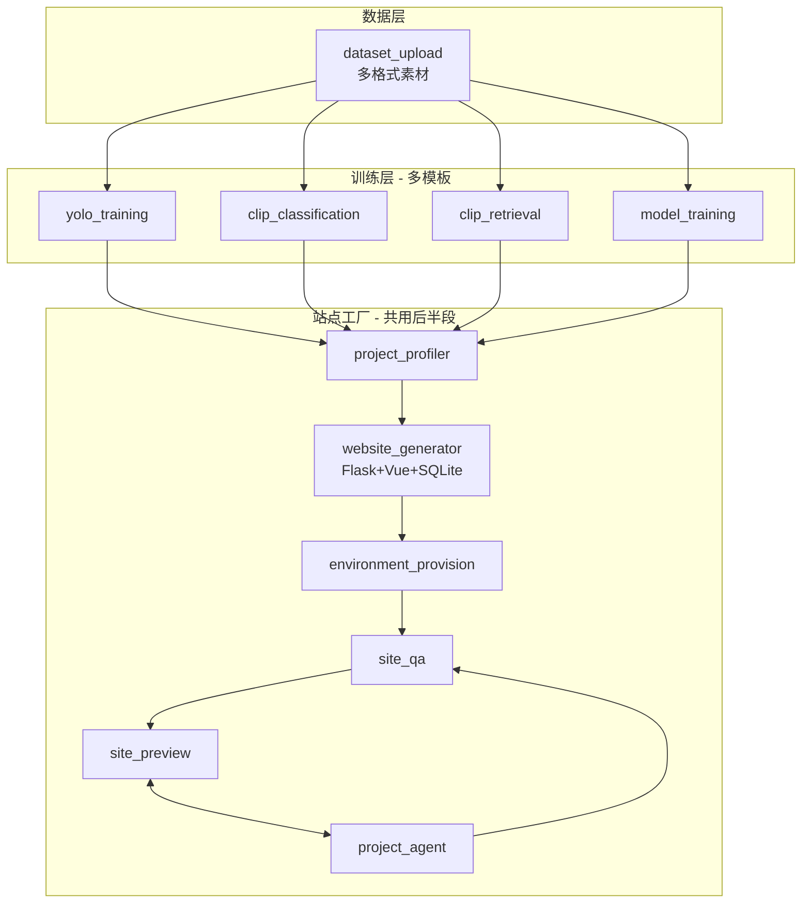

# Desktop ML 站点工厂 — 优化文档体系

> **范围**：Flowly Desktop + 工作流 MLOps 链路（训练 → 画像 → 建站 → 环境 → QA → 预览 → 项目 Agent）  
> **不包含**：Django Admin UI（见 [`Docs/admin-ui-optimization/`](../admin-ui-optimization/README.md)）  
> **最后更新**：2026-06-12

---

## 一、这套文档是干什么的

本目录将 **「本地模型训练 + AI 生成识别/检索站 + 全面自查 + 节点内预览 + 专属 Agent 迭代」** 拆成 **M1 → M4 四个里程碑**，每份文档包含：

- 为什么要做、与现有代码的关系
- 具体任务清单（可勾选）
- 节点 I/O 契约与状态机（见 `references/`）
- 完成标准与验收条件

**用法**：先读 [`00-product-decisions.md`](00-product-decisions.md) 锁定产品决策 → 在 [`PROGRESS.md`](PROGRESS.md) 更新进度 → **文档验收通过后再切 Agent 模式写代码**。

---

## 二、目标架构概览

**运行时**：以 **Flowly Desktop** 为主（本地权重、本地起服务、Playwright QA、iframe 预览）。

---

## 三、文档目录

| 文件 | 说明 |
|------|------|
| [`PROGRESS.md`](PROGRESS.md) | **进度看板**（优先看这个） |
| [`00-current-state.md`](00-current-state.md) | 代码现状 vs 目标差距 |
| [`00-product-decisions.md`](00-product-decisions.md) | **已定稿**：CLIP 形态、SQLite、QA 阈值、Profile |
| [`01-phase-m1-qa-preview-scaffold.md`](01-phase-m1-qa-preview-scaffold.md) | M1：SQLite scaffold + `site_qa` + `site_preview` + Desktop runtime |
| [`02-phase-m2-profiler-wizard.md`](02-phase-m2-profiler-wizard.md) | M2：`project_profiler` + 建站向导 |
| [`03-phase-m3-project-agent.md`](03-phase-m3-project-agent.md) | M3：专属 Agent + 改码强制 QA |
| [`04-phase-m4-clip-nodes.md`](04-phase-m4-clip-nodes.md) | M4：CLIP 分类/检索 + 数据集 format |
| [`05-acceptance-checklist.md`](05-acceptance-checklist.md) | 统一验收清单 |
| [`references/node-io-contracts.md`](references/node-io-contracts.md) | 各节点输入/输出 JSON 契约 |
| [`references/state-machines.md`](references/state-machines.md) | 站点生命周期与 QA 状态机 |
| [`references/qa-threshold-matrix.md`](references/qa-threshold-matrix.md) | 绿/黄/红灯阈值与 Profile |
| [`references/clip-retrieval-site-spec.md`](references/clip-retrieval-site-spec.md) | CLIP 检索站 4 Tab + API |
| [`references/key-files-index.md`](references/key-files-index.md) | 关键代码路径速查 |

---

## 四、建议阅读与实施顺序

1. [`00-product-decisions.md`](00-product-decisions.md) — 产品决策锁稿  
2. [`00-current-state.md`](00-current-state.md) — 了解起点  
3. [`01-phase-m1-qa-preview-scaffold.md`](01-phase-m1-qa-preview-scaffold.md) — **P0，先能测、能看**  
4. [`02-phase-m2-profiler-wizard.md`](02-phase-m2-profiler-wizard.md) — 提升建站针对性  
5. [`03-phase-m3-project-agent.md`](03-phase-m3-project-agent.md) — 闭环迭代  
6. [`04-phase-m4-clip-nodes.md`](04-phase-m4-clip-nodes.md) — 扩展训练面  
7. [`05-acceptance-checklist.md`](05-acceptance-checklist.md) — 每里程碑收尾  

**最小可交付路径（M1）**：固定 scaffold + SQLite → `environment_provision` → `site_qa`（L1–L4）→ `site_preview`（Desktop iframe）。

---

## 五、与项目其他文档的关系

| 目录 | 关系 |
|------|------|
| [`Docs/project-audits/05-training-workflow/`](../project-audits/05-training-workflow/README.md) | 历史 YOLO/训练蓝图，**只读参考**；新实施以本目录为准 |
| [`Docs/project-audits/03-action-plans/e2e-interaction-audit.md`](../project-audits/03-action-plans/e2e-interaction-audit.md) | 每完成一阶段补按钮矩阵行 |
| [`Docs/admin-ui-optimization/`](../admin-ui-optimization/README.md) | 并行，互不合并 |
| [`Desktop/README.md`](../../Desktop/README.md) | Desktop 开发与训练 Agent 说明 |

---

## 六、设计原则（全阶段遵守）

1. **训练仅在工作流内** — 无独立 `/training` 页（已迁移，见 e2e 审计架构决策节）  
2. **生成站框架固定** — Flask + Vue + SQLite；AI 填槽位，不自由生成全栈  
3. **改码必过 QA** — `project_agent` 任何代码变更触发 `site_qa` 全量重跑  
4. **Desktop 优先** — 预览与 QA 在本地起服务，权重路径本地可读  
5. **双 Profile** — `default`（小白严）与 `research`（学者可黄灯预览）  
6. **浏览器测试** — 使用 `chrome-devtools` MCP，禁止 `cursor-ide-browser`  

---

## 七、文档验收标准（开始写代码前）

- [x] [`00-product-decisions.md`](00-product-decisions.md) 七项决策均已标记「已定稿」
- [x] [`references/node-io-contracts.md`](references/node-io-contracts.md) M1 涉及节点契约完整
- [x] [`references/state-machines.md`](references/state-machines.md) 站点与 QA 状态机无歧义
- [x] [`01-phase-m1-qa-preview-scaffold.md`](01-phase-m1-qa-preview-scaffold.md) 任务清单可执行
- [x] [`05-acceptance-checklist.md`](05-acceptance-checklist.md) M1 验收项与 M1 文档一致
- [x] [`PROGRESS.md`](PROGRESS.md) 阶段总览已初始化

**文档验收**：2026-06-12 通过，可启动 M1 代码实现。
