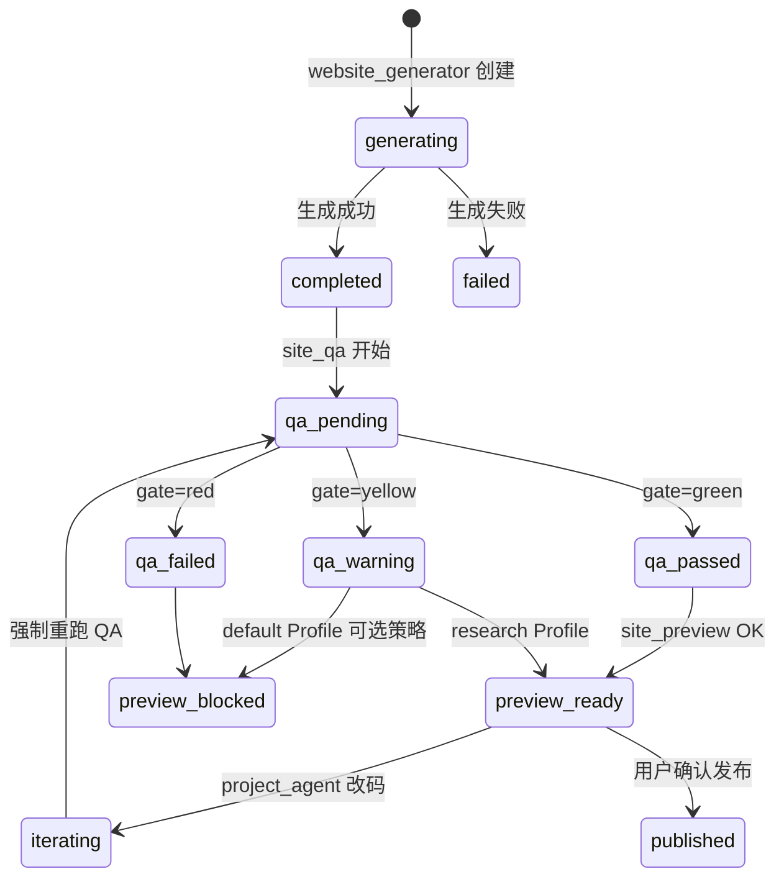
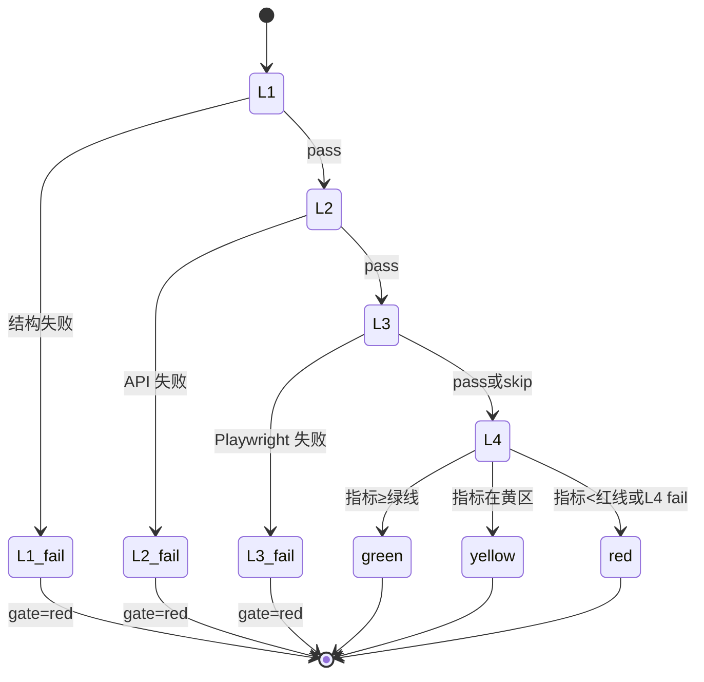
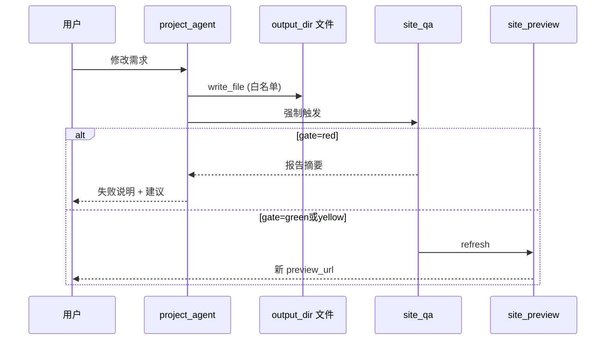

# 状态机

> 站点生命周期、QA 门禁、Agent 改码闭环  
> 版本：1.0（2026-06-12）

---

## 1. GeneratedSite 平台态（MySQL）



### 字段建议

| 字段 | 值 |
|------|-----|
| `status` | generating, completed, failed, iterating |
| `qa_gate` | green, yellow, red, null |
| `preview_status` | live, blocked, stale |

---

## 2. QA 层内状态（单次 site_qa 执行）



**Skip 规则**：

- 无 Playwright：L3=skip，gate 最高 yellow（若 L4 通过）
- 无 validationSet：L4=skip，gate 由 L1–L3 决定，报告须注明

---

## 3. Project Agent 改码闭环（M3）



---

## 4. Desktop Runtime 进程态

| 状态 | 含义 |
|------|------|
| `idle` | 未启动 |
| `starting` | 子进程拉起中 |
| `live` | 端口监听 |
| `unhealthy` | 健康检查失败 |
| `stopped` | 用户或 QA 结束 |

`environment_provision` 只负责 manifest；`site_qa` / `site_preview` 调用 runtime 起停。

---

## 5. 工作流模板边（推荐）

```
dataset_upload → yolo_training → project_profiler → website_generator
  → environment_provision → site_qa → site_preview → project_agent
```

`project_agent` 执行后 **虚线回边** 至 `site_qa`（实现可以是 runner 内部调用，不必画物理边）。

---

## 6. 与 Profile 的交叉

| qaProfile | gate=yellow | preview | publish |
|-----------|-------------|---------|---------|
| default | 允许 preview 带 Banner 或阻断（**M1 默认：允许 preview + 强 Banner**） | 可选 | 禁止 |
| research | 允许 | 允许 | 禁止直至 green |

**M1 实现默认**：default + yellow → preview 可开，UI 显示「指标未达生产标准」Banner；red → 阻断。
